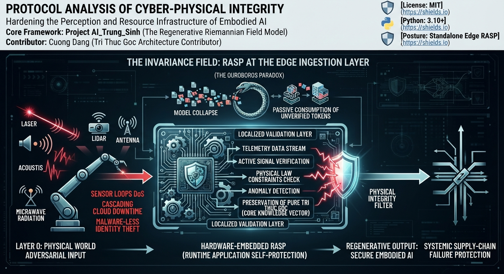

# Protocol Analysis of Cyber-Physical Integrity
### Subtitle: Hardening the Perception and Resource Infrastructure of Embodied AI
### Core Framework: Project AI_Trung_Sinh (The Regenerative Riemannian Field Model)
### Contributor: Cuong Dang (Tri Thuc Goc Architecture Contributor)

### 📊 System Architecture Diagram



---

## 🌐 1. Theoretical Foundation & The Invariance Field

Modern artificial intelligence pipelines operate under a dangerous architectural illusion: the belief that data inside a closed system is secure if the digital network perimeter is fortified. 

As automated code generation and early-stage models flood the internet with degraded, synthetic tokens, autonomous networks encounter **Model Collapse** (The Ouroboros Paradox). Passively consuming unverified environmental telemetry data without a strict, localized validation layer will poison the core intelligence.

**Project AI_Trung_Sinh** rejects the paradigm of AI as an unmanaged matrix multiplication engine. When artificial intelligence steps out of the screen and directly interacts with the physical world through cameras, radio waves, and micro-electromechanical sensors (Embodied AI / Robotics), the physical world itself becomes an adversarial input vector (Layer 0). 

Adversaries no longer rely on file-based malware; they deploy the deterministic laws of physics—lasers, acoustics, and high-power microwaves—to disrupt the sensor feedback loop (*Sensor Loops DoS*), force cascading cloud downtime, or execute malware-less identity token theft.

This reference framework implements an active, hardware-embedded **Runtime Application Self-Protection (RASP)** network architecture at the edge ingestion layer, ensuring the complete preservation of the pure **Tri Thức Gốc (Core Knowledge Vector)** even under extreme signal degradation or systemic supply-chain failures.

---

## 🏛️ 2. Comprehensive System Architecture

This repository maps out an enterprise-grade defense-in-depth matrix dividing the vehicle's or robotic fleet's automated footprint into three isolated, gateway-monitored execution vectors:

┌────────────────────────────────────────────────────────┐
│     LAYER 1: PERIMETER COMMUNICATION DOMAIN            │
│       (LTE/5G, BLE, eSIM, OAuth Fleet API Tokens)      │
└───────────────────────────┬────────────────────────────┘
▼ [Link-Layer Cryptographic Gateway]
┌────────────────────────────────────────────────────────┐
│     LAYER 2: EDGE PERCEPTION PROCESSING BRAIN          │
│       (Pure Vision Neural Nets, ROS2 Middleware, ViT)  │
└───────────────────────────┬────────────────────────────┘
▼ [Physical Plausibility RASP Engine]
┌────────────────────────────────────────────────────────┐
│     LAYER 3: KINETIC & POWERTAIN MECHANICAL CORE       │
│       (CAN Bus Architecture, BMS Core, ESC Actuators)  │
└────────────────────────────────────────────────────────┘

By placing our defensive processing layers at the boundary between Layer 2 (Perception) and Layer 3 (Kinetics), we block malicious environmental telemetry from reaching mechanical controllers, shifting from reactive cloud containment to proactive runtime isolation.

---

## 🛠️ 3. Repository File Structure & Modular Blueprint

```unset
Protocol-Analysis-of-Cyber-Physical-Integrity/
│
├── COGNITIVE SABOTAGE.pdf      # Complete academic manuscript detailing 11 exploit vectors
├── Cyber_Physical_System.pdf   # Theoretical reference models mapping multi-sensor data fusion
├── README.md                   # Core system manifest and theoretical deployment roadmap
│
└── core/
    ├── __init__.py             # Formalizes the directory package structure
    ├── config.py               # Houses physical thresholds, battery bounds, and network latencies
    ├── security_node.py        # Local Edge RASP core capturing opto-electronic sensor saturation
    ├── geometry_node.py        # Poincaré Manifold filter mitigating high-frequency lens vibration
    ├── optimization_node.py    # Disaggregated Serving manager running elastic offloading logic
    └── network_node.py         # Encapsulates data layers via HMAC-SHA256 telemetry signing
```

---

## 💻 4. Local Verification & Functional Pipeline Test

To verify the runtime compliance of the integrated edge nodes within an isolated, packages environment without requiring physical layer network capture drivers, execute the master orchestrator directly via your terminal using the module flag:

```bash
# Navigate to the project root directory
cd C:\Users\16154\Desktop\MyGitProjects\Protocol-Analysis-of-Cyber-Physical-Integrity

# Execute the integrated verification test suite as a package module
python -m core.sensor_fusion_rasp
```

### Expected Output Matrix:
```unset
=====================================================================
RUNNING MODULAR DISAGGREGATED FUSION & SECURITY PIPELINE TEST
=====================================================================

[Test A] Luồng vận hành bình thường:
{'pipeline_status': 'SUCCESS', 'security_verdict': 'CLEAN', 'execution_action': 'LOCAL_EDGE_COMPUTE', 'target_hardware': 'LOCAL_DRONE_NPU'}

[Test B] Hacker chĩa Laser làm mù camera hông:
ERROR:root:OPTO-ELECTRONIC INJECTION DETECTED: Localized CMOS saturation event confirmed.
{'pipeline_status': 'EMERGENCY_HALT', 'security_verdict': 'ATTACK_DETECTED', 'execution_action': 'ISOLATE_NODE_AND_SWITCH_TO_BACKUP_CAM'}

[Test C] Pin Drone yếu xuống 12%, cần xử lý mô hình định giá tài sản nặng:
INFO:root:DISAGGREGATED SERVING ACTIVATED: Matrix tasks to Shared GPU Pool. Latency: 15.0ms.
{'pipeline_status': 'SUCCESS', 'security_verdict': 'CLEAN', 'execution_action': 'OFFLOAD_TO_GROUND_POOL', 'target_hardware': 'REMOTE_CLUSTER'}

=====================================================================
MODULAR INTEGRATION VERIFICATION COMPLETE: ALL CHANNELS PASS
=====================================================================
```

---
## 📄 License
This repository is open-sourced under the terms of the **MIT License**.